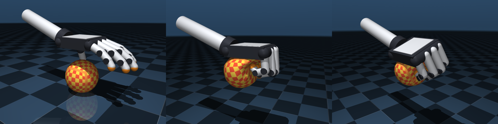

# Dexterous hand grasping a soft ball

A five-fingered hand picks up a deformable ball, squeezes it, turns it and sets it back down.
The hand is built from primitive geoms and the ball is a volumetric
[flex](https://mujoco.readthedocs.io/en/latest/modeling.html#cdeformable) with continuum elasticity, so
it visibly flattens against the palm and bulges between the fingers.

<p float="left">
  
</p>

| File | Contents |
| --- | --- |
| [`hand.xml`](hand.xml) | The hand on a 6-dof mount: 26 joints, 22 position actuators and 5 fingertip touch sensors. |
| [`soft_grasp.xml`](soft_grasp.xml) | The scene: a table and a 9 cm soft ball, including `hand.xml`. |
| [`soft_grasp.py`](soft_grasp.py) | A scripted grasp controller that runs in the interactive viewer or records a video. |

## Running

From this directory:

```bash
pip install mujoco
python soft_grasp.py                    # watch it in the interactive viewer
python soft_grasp.py --loop             # ... and repeat the sequence
python soft_grasp.py --headless         # simulate only and print a summary
```

To record a video, install `imageio[ffmpeg]` and run `python soft_grasp.py --record grasp.mp4`
(or `--record grasp.gif`, which only needs Pillow). On a machine without a display, select an
offscreen OpenGL backend first, e.g. `MUJOCO_GL=egl`. The scene can also be opened directly with
`python -m mujoco.viewer --mjcf=soft_grasp.xml` and the hand driven with the actuator sliders.

The script plays a sequence of hand poses that is adapted to the measured state of the ball: the hand
centers its palm over the ball, descends until the palm touches it, swings the thumb behind it, wraps
the fingers around it, lifts it 16 cm, squeezes it harder and relaxes, rolls the wrist back and forth,
lowers it by exactly its measured height above the table, relaxes its grip and lets go. With
`--squeeze` the grip strength can be scaled; values between 0.5 and 1.3 compress the ball by up to
6–19%, while much harder grips squeeze it out of the hand.

## The hand

The palm frame has `x` pointing toward the fingers, `y` toward the thumb and the palm facing `-z`, so
at the zero pose this right hand is palm-down with the fingers pointing along `+x`. The proportions are
roughly human: an 11 cm palm and a 10 cm middle finger.

- **Fingers.** Each finger has abduction, MCP and PIP joints with position actuators. The DIP joint
  follows the PIP joint through a joint equality (`dip = 0.8 pip`), as in tendon-driven fingers.
- **Thumb.** The base has in-plane abduction (`thumb_abd`, about the palm normal) followed by
  opposition (`thumb_rot`) about a diagonal axis, which swings the thumb from the plane of the palm to
  underneath it. Two flexion joints (`thumb_mcp`, `thumb_ip`) then curl it toward the fingers.
- **Mount.** Three slides and three hinges (`mount_*`, `wrist_*`) stand in for a robot arm. All hand
  bodies have `gravcomp="1"`, so the arm carries the weight of the hand.
- **Contacts.** Hand geoms have `contype="2" conaffinity="1"`: the hand collides with the ball and the
  table but not with itself. The orange fingertip pads have higher friction than the links.
- **Sensing.** `touch` sensors on the five distal phalanges measure the normal force on each
  fingertip, typically 1–6 N during the nominal grasp.

## The ball

The ball is a `flexcomp` of type `ellipsoid` with `dim="3"`, `mass="0.08"` and the elasticity of a
soft foam (`young="1.5e4"`, `poisson="0.3"`). Its deformation is parametrized by `dof="trilinear"`
with `cellcount="3 3 3"`, i.e. 64 nodes and 192 dofs, while collisions and rendering use the 387-vertex
surface given by `count="9 9 9"`. A checker texture makes the deformation easy to see.

## Modeling notes

- **Integrator and solver.** Implicit integration of flex elasticity requires
  `integrator="discrete"`. The CG solver is used with `iterations="100" tolerance="1e-6"`; the Newton
  solver also works and converges in fewer iterations at a similar cost per step.
- **Contacts.** Elliptic friction cones with `impratio="10"` keep the fingers from sliding on the
  ball, and a stiff contact `solref="0.004 1"` (twice the 2 ms timestep) limits penetration while the
  elasticity provides the softness.
- **Interpolation order.** With `dof="quadratic"` (e.g. `cellcount="2 2 2"`) some contacts of this
  scene get a vanishing regularizer and the solver diverges; the quadratic shape functions are negative
  on part of each cell, which the approximate constraint inertia does not account for. Trilinear cells
  avoid this and are sufficient for a ball.
- **Performance.** The whole sequence (13 s of simulated time) runs about 1.3× faster than real time
  on a single CPU thread. Most of the cost comes from the 55–130 contacts between the hand and the ball while
  it is held.
